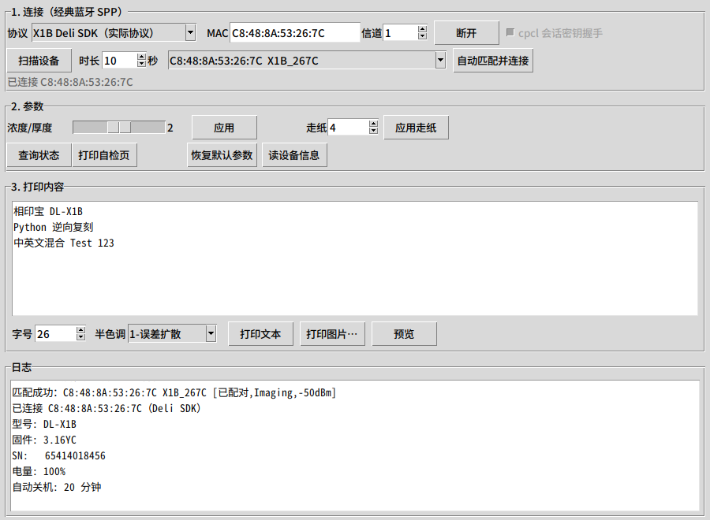
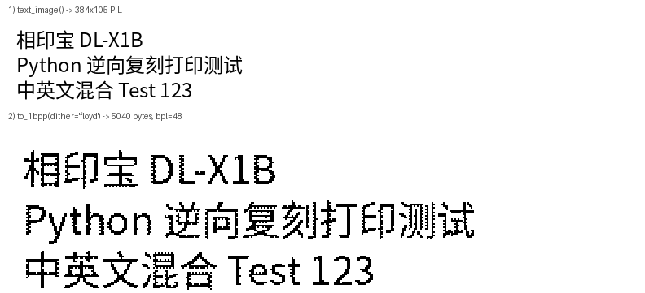

# DL-X1B（得力「相印宝」）蓝牙打印协议与 Python API 文档

本文档由逆向 `hwxyb.apk`（`com.feioou.abroad`，得力/斐欧「相印宝」App）得到，
目标是让一个**没有 Android 的 Python 程序**能够连接得力 DL-X1B 蓝牙热敏打印机并打印文本/图片。

> 结论先行：**DL-X1B 实际使用的是 App 内 `com.deli.sdk.PrintPP`（得利自研 SDK）**，
> 走经典蓝牙 SPP，命令是**无包头/无 CRC 的裸字节流**，图像用标准 ESC/POS
> `GS v 0`（`1D 76 30`）发送**未压缩 1bpp 点阵**，宽度 384 点。
> App 里另有一套 `cpcl` 协议（`02 … 03` 包封 + CRC32 + 会话密钥），但那是给
> 机型名含 `XiangYinBao_X1` 的旧 X1 用的，**DL-X1B 不走它**。
> 两套协议本仓库都实现了：`deliprint/`（DL-X1B 实际协议）与 `dlx1b/`（X1 cpcl）。

---

## 目录

- [1. 设备识别与连接](#1-设备识别与连接)
- [2. Deli SDK 协议（DL-X1B 实际使用）](#2-deli-sdk-协议dl-x1b-实际使用)
  - [2.1 命令表](#21-命令表)
  - [2.2 App 的真实打印时序](#22-app-的真实打印时序)
  - [2.3 图像数据格式（GS v 0）](#23-图像数据格式gs-v-0)
  - [2.4 应答、状态与分块](#24-应答状态与分块)
  - [2.5 一次打印的完整字节流](#25-一次打印的完整字节流)
  - [2.6 连上之后：App 的信息查询状态机](#26-连上之后app-的信息查询状态机)
  - [2.7 注意：App 的「打印文本」在 X1B 上疑似走错 SDK](#27-注意app-的打印文本在-x1b-上疑似走错-sdk)
- [3. Python API：`deliprint`](#3-python-apideliprint)
  - [3.5 自动扫描与匹配（`deliprint.discovery`）](#35-自动扫描与匹配deliprintdiscovery)
- [4. 示例](#4-示例)
- [附录 A：X1 机型的 cpcl 协议](#附录-ax1-机型的-cpcl-协议)
- [附录 B：未确认 / 已知风险](#附录-b未确认--已知风险)
- [附录 C：逆向证据索引](#附录-c逆向证据索引)



---

## 1. 设备识别与连接

### 1.1 App 是怎么认出 DL-X1B 的

`work/jadx_out/sources/com/feioou/abroad/views/main/MainActivity.java:124-147`
（`DeviceFragment` / `MyEquitmentActivity.java:315-360` 同逻辑）：

1. 蓝牙发现回调里，`BluetoothClass.getMajorDeviceClass() == 1536`（`0x600`，外设类）且设备名非空才显示；
2. 之后按**设备名**分支：

| 名字匹配 | 使用的打印实现 |
|---|---|
| `startsWith("X1B")` | `AYPrintUtil` → **`com.deli.sdk.PrintPP`**（本文第 2 章） |
| `startsWith("X3B")` | `AYPrintUtil` → Deli SDK |
| `startsWith("XiangYinBao_X1")` | `HPRTX1PrintUtil` → `cpcl.Print`（附录 A） |
| `S501/S502`、`X3/X4/X7` 等 | `HPRTX3PrintUtil` → `HPRTAndroidSDK`（本文不涉及） |

`com/feioou/abroad/views/base/Contants.java` 里 `X1_NAME = "XiangYinBao_X1"`，
所以设备名只有 `X1B` 时**不会**误入 X1 分支；`DEVICETYPE_X1B = "X1B"`。

扫描列表的过滤条件（`com/feioou/abroad/views/addequitment/MyEquitmentActivity.java:87`）：

- 名字 `contains` 任一：`XiangYinBao` / `X1B` / `X3B` / `S501` / `S502` / `THERMAL PRINTER`；
- 且名字**不含** `BLE`（本机型不走 BLE）；
- 且 `BluetoothClass.getMajorDeviceClass() == 1536`（`0x600`，外设类）；
- 不按 MAC、不按 service UUID 过滤；已配对设备在 `MainActivity.java:122-147` 自动重连。

`device_type` 是**调用方传入的字符串常量**（如 `"X1B"`），**连接前不读 SN/型号**；
SN、版本这些是连上之后才查（见 2.6）。

### 1.2 连接参数

- 传输层：**经典蓝牙 SPP（RFCOMM）**，不是 BLE；没有 service/characteristic UUID、没有 notify/MTU。
- 服务 UUID：`00001101-0000-1000-8000-00805F9B34FB`
  （`com/deli/sdk/a.java:110-111`，**secure** `createRfcommSocketToServiceRecord`；
  注意同 App 的 cpcl 包用的是 insecure 版本，两者不同）。
- 连接重试：失败后每 **200ms** 再连一次，直到 **3000ms** 超时
  （`a.java:112-158`；`e.c` 传入 timeout=3000）。**没有** channel 反射 fallback。
- 等蓝牙适配器 `state == 12`（STATE_ON），每 200ms 轮询、超时取 `max(timeout, 1000)`。
- 写：`OutputStream.write(data, off, len)`，**不 flush、不重试**，失败由上层处理。
- 读：轮询 `InputStream.available()`，有数据才读；查询/状态是异步的。

> Python 差异：标准库 `AF_BLUETOOTH` 只能按 **RFCOMM 信道号**连接，没有 SDP 查询接口，
> 所以 `BtSppTransport` 默认 `channel=1`（SPP 标准信道），并复刻「每 200ms 重连、3s 超时」。
> 若 1 连不上，可在 `DeliPrinter.connect_bt(mac, channel=...)` 里试 1–30。
- 连接前打印机必须**已配对**（系统蓝牙设置里配过一次即可），Python 侧不做配对/授权。
- 设备名示例：`X1B-XXXX`（MAC 可在系统蓝牙列表看到）。

---

## 2. Deli SDK 协议（DL-X1B 实际使用）

要点：

- 命令就是**直接写进 socket 的字节**，没有包头、长度、CRC、序号。
- 命令绝大多数是 `10 FF …`（`0x10 0xFF` 开头，类 ESC/POS 私有扩展）或标准 ESC/POS（`1B …`、`1D …`）。
- 写满 **1024 字节**为一块，块与块之间 `sleep 1ms`（`com.deli.sdk.e.a(byte[], boolean)`）。
- App 代码里只处理两个应答：状态推送 `FF xx`（2 字节）和打印完成 `"OK"`（`4F 4B`）。
  （本机固件实测不推这两种，见 2.4 末尾。）

### 2.1 命令表

全部来自 `com/deli/sdk/e.java` + `work/apktool_out/smali/com/deli/sdk/e.smali` 的
`.array-data`（jadx 把字节常量显示成 `NumberPtg.sid` 之类的符号名，真实值以 smali 为准）。

| 功能 | `PrintPP` 方法 | 字节 |
|---|---|---|
| 使能打印 | `enablePrinter()` | `10 FF FE 01` |
| 结束打印作业 | `stopPrintJob()` | `10 FF FE 45` |
| 退纸 | `backoffPaper()` | `10 FF FE 40` |
| 使能/禁用 | `setIsConnect(boolean)` | `10 FF 60 01` / `10 FF 60 00` |
| 唤醒 | `printerWakeup()` | **1024 个 `0x00`** |
| 选纸张类型 | `choosePaperType(i)` | `10 FF 84 <i>`（2 英寸传 3，4 英寸传 4） |
| 走纸（点行） | `printLinedots(n)` | `1B 4A <n>`（ESC J n，n≤255） |
| 打印位置 | `printerPosition()` | `1D 0C` |
| 学习标签间距 | `learnLabelGap()` | `10 FF 03` |
| 查询状态 | `printerStatus()` | `10 FF 40` |
| 查询版本 | `printerVersion()` | `10 FF 20 F1` |
| 查询 SN | `PrinterSN()` | `10 FF 20 F2` |
| 查询型号 | `PrinterModel()` | `10 FF 20 F0` |
| 查询蓝牙版本 | `printerBtVersion()` | `10 FF 30 10` |
| 查询蓝牙名 | `printerBtname()` | `10 FF 30 11` |
| 查询蓝牙 MAC | `printerMac()` | `10 FF 30 12` |
| 查询电量 | `printerBatteryVol()` | `10 FF 50 F1` |
| 查询电量（备） | — | `10 FF 50 F0` |
| 连续纸/标签纸 | e.b(boolean) | `10 FF 60 01` 连续纸 / `10 FF 60 00` 标签纸（App 未调用） |
| 查询关机时间 | e.u()（App 当"关机时间"读） | `10 FF 13` |
| 查询纸张类型 | `getPaperType()` | `10 FF 85` |
| 检查闪存图片 | `checkbmpFromFlash()` | `10 FF 15 06` |
| 恢复/复位 | e.r() | `1F B2 10` |
| 关机时间 | `setShutTime(s)` | `10 FF 12 <hi> <lo>` |
| 打印浓度/厚度 | `setThickness(v)` | `10 FF 10 00 <v>` |
| 设置时间 | `setCurrentTime(...)` | `10 FF 14 02 <y> <mo> <d> <h> <mi> <s>` |
| 打印位图 | `printBitmap(bitmap, mode)` | `1D 76 30 <mode> <xL> <xH> <yL> <yH>` + 点阵 |

> 注意 `printerStatus()` 的返回值**只是"命令写进 socket 了"**，真正的状态由打印机
> 主动推送 `FF xx`（见 2.4）。

### 2.2 App 的真实打印时序

`com/feioou/abroad/views/preprint/PrePrintImgActivity.java:665-681`
（`device_type == "X1B" || "X3B"` 分支）：

```
printPP.enablePrinter();          // 10 FF FE 01
printPP.printerWakeup();          // 1024 × 0x00
printPP.choosePaperType(3);       // 10 FF 84 03      （2 英寸）
printPP.printLinedots(0);         // 1B 4A 00
printPP.printBitmap(bitmap, 0);   // 1D 76 30 00 … + 点阵
printPP.printLinedots(140);       // 1B 4A 8C
printPP.stopPrintJob();           // 10 FF FE 45
```

图片在发送前被 App 处理过：

- `BitmapFlex.compressPic()`（`com/feioou/abroad/utils/BitmapFlex.java:319-349`）：
  `device_type` 含 `"X1B"` → 目标宽度 `Contants.X1_RADIO = **384**`，等比缩放、白底；
- `HPRTPrinterHelper.getBWjitterBitmap(bitmap, 1)`（`HPRTPrinterHelper.java:1788`）：
  先做一次 HPRT 侧半色调/抖动（模式 1）得到纯黑白图；
- 长图再用 `ImageSplitter.split(...)` 按纸张尺寸分页，每页重复上面的打印时序。

补充（`PrePrintImgActivity.java:665-681` + `PrintUtil.java` 复核）：

- `printBitmap` 的 `mode` **硬编码 0**，App 的浓度/打印模式设置对 X1B 不生效；
- 命令之间**没有显式延时**，只靠 SDK 内部 1024 分块的 1ms sleep 限速；
- 打印份数是上层 `for` 循环，**每份都完整重发上面整套 7 条命令**；
- 384 点宽是 App 侧 `BitmapFlex.compressPic` 缩出来的（`Contants.X1_RADIO=384`），
  Deli SDK 本身**对任意宽高都接受**（`e.java:406` 无校验），`bpl = ceil(width/8)`。

Python 侧用 `dither="floyd"` 近似 App 的 `getBWjitterBitmap` 预处理（见附录 B 的说明）。

### 2.3 图像数据格式（GS v 0）

**帧头（8 字节）**，`com.deli.sdk.e.d(Bitmap,int)`：

```
1D 76 30 <mode> <xL> <xH> <yL> <yH>
```

- `mode`：0..3（App 恒传 0；SDK 会把越界值钳到 0）；
- `xL/xH`：每行字节数 `bpl = ceil(width/8)`，**小端**；
- `yL/yH`：行数 `height`，**小端**；
- 头之后紧跟 `bpl * height` 字节点阵。

**点阵打包规则**，`com.deli.sdk.e.a(Bitmap,w,h)`：

- 每行 `ceil(w/8)` 字节；位序 **MSB 在前**：`bit = 1 << (8 - i)`，i = 1..8；
- **1 = 黑**，0 = 白；
- 判黑条件：`(R + G + B) / 3 < 128`（**算术均值**，不是亮度加权）；
- 全白像素（`pixel == -1`）直接跳过，不参与判断；
- DL-X1B 的纸宽是 384 点（App 侧约定），于是 `bpl = 48`、一行 48 字节；
  SDK 本身不校验宽度，其它机型/纸型可以更窄或更宽。

384×h 点阵的字节数是 `48 * h`，例如 78 行 = 3744 字节。

### 2.4 应答、状态与分块

**状态推送（2 字节）**，`com.deli.sdk.b.run()`：

| 字节 | 含义 | App 回调 |
|---|---|---|
| `FF 00` | 正常 | `onNormal()` |
| `FF 04` | 缺纸（bit2） | `onOutPaper()` |
| `FF 08` | 电池电量低（bit3） | `onLowVal()` |
| `4F 4B`（"OK"） | 一页打印完成 | `onPrintFinish()` |
| 其它 | 查询应答（SN/版本/型号…） | `onReceive(byte[])` |

**分块**：`com.deli.sdk.e.a(byte[], boolean)`：

- 每块 `1024` 字节，块间 `Thread.sleep(1)`；
- 最后一层仍是同一个 `OutputStream.write(data, off, len)`，没有应用层确认。

**读线程**：每 1ms 轮询一次输入流（`a.b(2000)`，最多等 2000ms），
所以状态推送是**异步**的，打印期间要持续读 socket，否则状态/OK 会积压。

两个实现细节（真机排查时会遇到）：

- 状态判定要求**整包恰好 2 字节**（`len == 2 && b[0] == 0xFF`）。固件若把 `FF xx`
  和别的字节粘在同一个 read 里，SDK 会漏判——本库按同样的规则匹配，遇到异常数据会
  原样交给 `on_receive`，不猜测。
- 状态**只有 3 种**：正常 / 缺纸 / 低电压。**没有开盖、过热、卡纸**这类 cpcl/HPRT 才有的状态位。
- `"OK"` 只有在 `l == true`（即刚调用过 `printBitmap`）时才当打印完成，否则也交给 `on_receive`。

**真机实测（固件 `3.16YC`，2026-11-07，设备 `C8:48:8A:53:26:7C X1B_267C`）**

SDK 期望的 `FF xx` 状态帧在本机固件上**从未出现**。真实观察到的回包是：

| 触发 | 回包 | 说明 |
|---|---|---|
| `10 FF 40`（状态查询） | 单字节 `00` | 正常；没有异步状态推送 |
| `stopPrintJob`（`10 FF FE 45`）后 ≈1.5s | `AA` | 任务被打印机接受/开始 |
| 再 ≈0.6s 后 | `BB` | 任务结束 |
| 字符串查询（型号/版本/SN） | 裸 ASCII/GBK，**无包头** | 如 `33 2e 31 36 59 43` = `"3.16YC"` |
| 数值查询（电量/关机时间） | 2 字节，首字节 0 | `00 64` = 100%，`00 14` = 20 分钟 |

因此本库把 **`"OK"` 或 `AA`+`BB` 都判为完成**（真机 `wait_print_finished()` 2.6s 返回 True）；
`FF xx` 状态推送仍保留支持，用于兼容其它固件。

### 2.5 一次打印的完整字节流

`python3 demo/print_text_cli.py --text "你好 DL-X1B\nPython 逆向复刻" --dump work/frames_deli.hex`
（384×78 点阵，离线模式）：

```
 1. enablePrinter                      4 B
 2. printerWakeup（1024 个 0x00）     1024 B
 3. choosePaperType(3) 2 英寸           4 B
 4. 走纸 0 点行                          3 B
 5. GS v 0 模式 0：384 点宽 × 78 行，3744 字节   3752 B
 6. 走纸 140 点行                        3 B
 7. stopPrintJob                       4 B
```

合计 4794 字节。前 16 字节：`10 ff fe 01 00 00 00 00 00 00 …`。



### 2.6 连上之后：App 的信息查询状态机

`com/feioou/abroad/printutils/AYPrintUtil.java:32,77-79` 在 `connect` 成功后立刻
`getDeviceInfomation()` → `printPP.PrinterSN()`，随后 `MainActivity.java:385-465`
的 `onReceive` 按 `oprtetype` 逐条推进：

```
PrinterSN   (10 FF 20 F2) → device_sn   = new String(resp, GB2312)  → printerBatteryVol()
BatteryVol  (10 FF 50 F1) → device_ele  = resp[1]                   → getShutTime()
ShutTime    (10 FF 13)    → device_close_time = hex(resp)           → printerVersion()
Version     (10 FF 20 F1) → device_version = new String(resp,GB2312)→ printerStatus()
Status      (10 FF 40)    → 位解析 &1/&4/&8                          → 结束
```

`PrinterModel()`（`10 FF 20 F0`）在这条链里**没有**被调用；SN 也**不是**连接前用来认机型的。
真机实测回包（固件 `3.16YC`，`read_*` 就是按这些格式解析的）：

| 查询 | 命令 | 回包 | 解析结果 |
|---|---|---|---|
| 型号 | `10 FF 20 F0` | `44 4c 2d 58 31 42` | `"DL-X1B"` |
| 固件版本 | `10 FF 20 F1` | `33 2e 31 36 59 43` | `"3.16YC"` |
| SN | `10 FF 20 F2` | `36 35 34 31 34 30 31 38 34 35 36` | `"65414018456"` |
| 电量 | `10 FF 50 F1` | `00 64` | `resp[1]` = 100（%） |
| 自动关机 | `10 FF 13` | `00 14` | `resp[1]` = 20（分钟） |
| 状态 | `10 FF 40` | `00` | 0 = 正常 |

Python 侧两种用法：

- **异步**：`read_all_info()` / `get_*()`，应答走 `on_receive`；
- **同步**：`request(cmd)`，以及 `read_model() / read_version() / read_sn() /
  read_battery() / read_shut_time() / read_status()`，一问一答直接返回解析后的值。

链路被系统回收（`Errno 107/104`）时 `_raw` 会自动 `reconnect()` 一次并重发；
也可以主动调用 `p.reconnect()`。

### 2.7 注意：App 的「打印文本」在 X1B 上疑似走错 SDK

静态链路（`work/notes/deli_verify.md` §8 有逐跳证据）：

```
TextNormalFragment → ScreeUtils.shotScrollView（把 ScrollView 截图成 Bitmap）
  → PrePrintNormalActivity:636 → PrintUtil.startPrintImg → PrintUtil.HPRTprintImg
      if device_type == "X1"  → cpcl.Print.printBitmap     ← 只有 X1
      else                    → HPRTPrinterHelper.printBitmap ← X1B 落到这里
```

而 HPRT 通道的端口只在 `HPRTX3PrintUtil.java:24` 里 `PortOpen` 过，X1B 连接走的是
`printPP.connect()`，**从未打开 HPRT 端口** → 静态判断文本打印在 X1B 上会失败
（疑似 App 自身分支缺失）。是否 UI 上对 X1B 隐藏了文本打印入口，静态分析无法确证，
**需真机验证**；图片打印走 `PrePrintImgActivity` 的 X1B 分支，是正常的。

本库的 `print_text` 自己渲染+打包后走 `print_raster`，不依赖上述 App 逻辑。

---

## 3. Python API：`deliprint`

`deliprint/` 是**独立、零第三方依赖（Pillow 仅用于渲染文本/图片）**的核心包，
只包含"连打印机 + 发图像数据"需要的全部内容：
`commands.py`（命令）、`raster.py`（点阵打包/抖动/文本渲染）、
`transport.py`（SPP/TCP/串口/回环）、`printer.py`（打印流程与状态机）。

### 3.1 安装

```bash
pip install pillow            # 仅打印文本/图片时需要
pip install pyserial          # 仅走串口时需要
```

Linux 直连蓝牙需要 `python3` 的 `socket.AF_BLUETOOTH`（官方 CPython 自带）：

```bash
sudo apt install bluez
bluetoothctl devices          # 确认打印机已配对，记下 MAC
```

Windows 不需要任何蓝牙第三方库：扫描走系统 API `bthprops`（ctypes），SPP 连接走
winsock（`WSASocket` + `BTHPROTO_RFCOMM`），只用标准库。**先在「设置 → 蓝牙和其他
设备」里配对该打印机**（配对后即使它休眠也能被枚举到），然后直接：

```powershell
python demo\print_test_gui.py
```

macOS 没有 `socket.AF_BLUETOOTH`，请用 `SerialTransport`（已配对串口）。

### 3.2 顶层 API（`import deliprint`）

| 名字 | 说明 |
|---|---|
| `DeliPrinter` | 打印驱动（连接/命令/打印/状态） |
| `DeliPrinter.connect_bt(mac, channel=1)` | 连接并返回实例 |
| `BtSppTransport(mac, channel=1, timeout=3.0)` | 蓝牙 SPP 传输层（每 200ms 重连，3s 超时；Linux 用 `AF_BLUETOOTH`，Windows 自动走 winsock） |
| `LoopbackTransport(ack=True)` | 虚拟打印机（离线验证/GUI 演示），`.written` 是发出的字节 |
| `SocketTransport(host, port)` / `SerialTransport(port, baud)` | TCP 透传 / 串口 |
| `to_1bpp(img, dither="threshold")` | PIL 图 → `(w, h, bytes)` 1bpp 点阵 |
| `text_image(text, font_size=24, width=384, ...)` | 文本 → PIL 灰度图（自动折行、裁白边） |
| `fit_width(img, width=384)` | 等比缩放到打印机宽度 |
| `raster_header(bpl, height, mode=0)` | 生成 8 字节 `1D 76 30 …` 帧头 |
| `PRINTER_WIDTH` / `BYTES_PER_LINE` / `CHUNK` | 384 / 48 / 1024 |

### 3.3 `DeliPrinter`

```python
DeliPrinter(transport, auto_read=True, debug=False, auto_reconnect=True)
```

**连接**

| 方法 | 说明 |
|---|---|
| `connect()` / `disconnect()` | 打开/关闭传输层；`auto_read=True` 时起后台读线程 |
| `connect_bt(mac, channel=1, **kw)` | 类方法：连接 SPP 并返回实例（记下 MAC 供自动重连） |
| `auto_connect(duration=8.0, patterns=None, ...)` | 类方法：扫描 → 匹配 → 连接，失败抛 `PrinterError` |
| `reconnect()` | 关掉旧 socket 后重连（`_raw` 遇 `Errno 107/104` 也会自动做一次） |
| `with DeliPrinter(LoopbackTransport()) as p:` | 上下文管理 |

**打印流程（对应 2.2）**

| 方法 | 发出的字节 |
|---|---|
| `enable()` | `10 FF FE 01` |
| `wakeup()` | 1024 × `0x00` |
| `choose_paper_type(t=3)` | `10 FF 84 <t>` |
| `feed(n)` | `1B 4A <n>`（点行，n ≤ 255） |
| `print_raster(data, bpl, height, mode=0)` | 帧头 + 点阵（1024 分块） |
| `print_image(img, mode=0, dither="threshold")` | `fit_width` → `to_1bpp` → `print_raster` |
| `print_text(text, dither="floyd", font_size=24)` | 文本 → 图 → 打印 |
| `print_text_page(text, ...)` | 完整一页：enable→wakeup→paper→feed0→图→feed140→stop |
| `print_image_page(img, paper_type=3, **kw)` | 同上，打图片（**图片必须用这个**，单独 `print_image` 只是发点阵） |
| `stop()` | `10 FF FE 45` |

**参数 / 查询 / 状态**

| 方法 | 说明 |
|---|---|
| `set_thickness(v)` | `10 FF 10 00 v`（打印浓度/厚度） |
| `set_shut_time(s)` | `10 FF 12 hi lo` |
| `set_paper_mode(continuous=True)` | `10 FF 60 01` / `10 FF 60 00`（App 未用） |
| `get_sn()` / `get_battery()` / `get_shut_time()` / `get_version()` | 对应查询命令（见 2.6） |
| `get_model()` / `get_bt_name()` / `get_bt_mac()` / `get_bt_version()` | 同上 |
| `get_paper_type()` / `printer_position()` | `10 FF 85` / `1D 0C` |
| `read_all_info()` | 按 App 顺序发 SN→电量→关机时间→版本→状态 |
| `learn_label_gap()` / `backoff_paper()` / `printer_position()` | 见 2.1 |
| `query_status()` | 发 `10 FF 40`；结果通过 `on_status` 回调 |
| `query(cmd)` | 发任意命令（如 `commands.QUERY_SN`） |
| `request(cmd, timeout=2.0)` | 同步一问一答，返回原始回包（超时 `b""`） |
| `read_model()` / `read_version()` / `read_sn()` / `read_bt_name()` | 同步查询并解码（GBK） |
| `read_battery()` / `read_shut_time()` / `read_paper_type()` / `read_status()` | 同步查询并返回整数 |
| `wait_print_finished(timeout=30)` | 等完成信号：`"OK"` 或 `AA`+`BB`（真机固件回后者） |

**回调**

```python
p.on_status = lambda code: ...            # FF xx 的 xx（0x04 缺纸 / 0x08 低压 / 0 正常）
p.on_print_finished = lambda: ...         # 收到 "OK"，或 AA→BB 序列结束
p.on_receive = lambda data: ...           # 其它应答（SN/版本/型号…）
```

### 3.4 点阵打包与半色调

`to_1bpp(img, dither=..., threshold=128)` 支持三种模式：

| `dither` | 算法 | 说明 |
|---|---|---|
| `"threshold"` | 均值 `(R+G+B)/3 < 128` | **原厂 SDK 的判据**，纯黑白图应选它 |
| `"floyd"` | Floyd–Steinberg（7/16,3/16,5/16,1/16 整数） | 近似 App 的 `getBWjitterBitmap`，照片/灰阶推荐 |
| `"bayer"` | 8×8 Bayer 有序抖动 | 文字/线稿，观感更"网点" |

---

### 3.5 自动扫描与匹配（`deliprint.discovery`）

不用手抄 MAC：按 App 的扫描规则找设备、打分排序、直接连。
后端按平台自动选择（`default_scanner()`）：Linux/BlueZ 用 `bluetoothctl`，
Windows 用系统蓝牙 API（`bthprops`），**都不需要 PyBluez / pywin32**。
Windows 上请先在「设置 → 蓝牙和其他设备」里配对该打印机；未配对设备也能被
inquiry 扫到，但连不上（`WSAEADDRNOTAVAIL 10049`）。

```python
import deliprint

deliprint.scan_devices(10)        # -> [Device(...), ...]（含所有蓝牙设备）
dev = deliprint.find_printer(10)  # -> 最匹配的 DL-X1B，找不到返回 None
print(dev)                        # C8:48:8A:53:26:7C X1B_267C [已配对,Imaging,-46dBm]

p = deliprint.DeliPrinter.auto_connect(10)   # 扫描→匹配→连接一条龙
p.print_text_page("hello")
p.disconnect()
```

**匹配规则**（复刻 `MyEquitmentActivity.java:87`，见 §1.1）

| 步骤 | 规则 |
|---|---|
| 名字模式 | 含 `XiangYinBao` / `X1B` / `X3B` / `S501` / `S502` / `THERMAL PRINTER` |
| 排除 | 名字含 `BLE`（DL-X1B 的 BLE 孪生是 OTA 通道，不能打印） |
| 设备类 | `device_class` 未知时放行；已知则要求 `major == 0x600`（Imaging） |
| 打分 | `DL-X1B` +120、命中名字模式 +100、含 `X1B` +30、已配对 +20、Imaging +10、RSSI 0..15 |

| 名字 | 说明 |
|---|---|
| `Device(mac, name, paired, rssi, device_class, source)` | 一台设备；`is_imaging` / `major_class` / `mac_display` |
| `BluezCtlScanner(ctl="bluetoothctl")` | Linux 扫描后端，`scan(duration)` 返回 `list[Device]` |
| `WindowsScanner(inquiry=True)` | Windows 扫描后端：先读系统缓存（已配对设备），`inquiry=True` 时再发起 inquiry |
| `default_scanner()` | 按平台返回上面的默认后端（`sys.platform` 以 `win` 开头 → Windows） |
| `Scanner` | 协议：任何实现 `scan(duration)` 的对象都能传进去（测试用 FakeScanner） |
| `scan_devices(duration=10, scanner=None)` | 扫描并按匹配度排序 |
| `scan_printers(...)` | 只要匹配上的打印机 |
| `find_printer(duration=10, patterns=None, scanner=None)` | 取最匹配的一台，或 `None` |
| `rank_devices(devices, patterns=...)` / `pick_device(...)` | 排序 / 取第一 |
| `score_device(dev, patterns=...)` | 打分，0 表示不匹配 |
| `is_x1b(name)` / `passes_app_filter(dev)` | 单条规则 |
| `ScanError` | 没有适配器 / `bluetoothctl` 缺失 / BlueZ 未启动 / Windows 蓝牙未打开 |

`patterns` 是**附加**模式（会与 App 默认模式合并），不是白名单。

**实测记录**（真机 DL-X1B，MAC `C8:48:8A:53:26:7C`，已配对）

```
$ python3 demo/print_text_cli.py --scan 8
发现 7 台设备（按匹配度排序）：
  C8:48:8A:53:26:7C X1B_267C [已配对,Imaging,-53dBm]
  13:05:AA:00:08:94 BT5.2 Mouse
  ...
  C9:48:8A:53:26:7C X1B_267C_BLE          ← 同名 BLE 孪生，被正确排除
最佳匹配：C8:48:8A:53:26:7C X1B_267C [已配对,Imaging,-53dBm]

$ python3 demo/print_text_cli.py --auto --text "hello"
连接 C8:48:8A:53:26:7C …
已发送，等待打印机完成 …
完成                                  ← 收到 AA+BB（≈2.6s），真机出纸
```

---

## 4. 示例

### 4.1 打印文本（最小可用）

```python
from deliprint import DeliPrinter

p = DeliPrinter.connect_bt("AA:BB:CC:DD:EE:FF")   # 打印机 MAC
try:
    p.print_text_page("你好 DL-X1B\n打印测试 Test 123", dither="floyd", font_size=24)
    p.wait_print_finished(timeout=30)
finally:
    p.disconnect()
```

### 4.2 打印图片

```python
from PIL import Image
from deliprint import DeliPrinter, fit_width

p = DeliPrinter.connect_bt("AA:BB:CC:DD:EE:FF")
img = fit_width(Image.open("photo.png").convert("L"))
p.enable(); p.wakeup(); p.choose_paper_type(3); p.feed(0)
p.print_image(img, dither="floyd")
p.feed(140); p.stop()
p.disconnect()
```

### 4.3 离线验证（不连打印机）

```bash
# 把要发的字节 dump 出来，并打印结构摘要
python3 demo/print_text_cli.py --text "hello" --dump work/frames_deli.hex

# 打印图片
python3 demo/print_text_cli.py --image photo.png --dump work/frames_img.hex
```

```python
from deliprint import DeliPrinter, LoopbackTransport

t = LoopbackTransport()
p = DeliPrinter(t); p.connect()
p.print_text_page("hello")
print(bytes(t.written).hex(" "))   # 完整字节流
```

### 4.4 图形界面

```bash
python3 demo/print_test_gui.py                        # 默认 Deli SDK（DL-X1B）
python3 demo/print_test_gui.py --auto                 # 启动即扫描、匹配、连接
python demo\print_test_gui.py                         # Windows（Linux 的 python3 换成 python）
python3 demo/print_test_gui.py --protocol cpcl        # 切到 X1 的 cpcl 协议
python3 demo/print_test_gui.py --mac AA:BB:CC:DD:EE:FF
```

界面支持：**扫描设备（时长可调）+ 设备下拉框 + 自动匹配并连接**、协议选择、连接、
浓度/厚度、走纸、状态查询、**读设备信息（型号/固件/SN/电量/自动关机）**、自检页、
恢复默认、文本打印、图片打印、点阵预览、日志。

> 真机实测：`--auto` 10s 扫描 → 匹配 `C8:48:8A:53:26:7C X1B_267C` → 连接 →
> 读信息（`DL-X1B` / `3.16YC` / `65414018456` / 100% / 20 分钟）→ 打印 → 2.6s 完成。

### 4.5 命令行：扫描与自动连接

```bash
python3 demo/print_text_cli.py --scan            # 只扫描并列出（默认 10s，可跟秒数）
python3 demo/print_text_cli.py --scan 15
python3 demo/print_text_cli.py --auto --text "自动匹配打印测试"
python3 demo/print_text_cli.py --auto --image photo.png
```

---

## 附录 A：X1 机型的 cpcl 协议

`dlx1b/` 包实现的是 App 中 `cpcl/Print` 这一套（`com.feioou.abroad.printutils.HPRTX1PrintUtil`
→ `cpcl.Print`），**DL-X1B 不使用**，但同一 App 的 X1 机型用它。保留它是为了：
① 覆盖同 App 的另一种机型；② 它是"包封 + CRC + 握手"的另一类设计，可作对照。

### A.1 帧格式

`cpcl/Tools.getBytes(cmd1, cmd2, payload)`：

```
02 | cmd1 | cmd2 | len_lo len_hi | payload | crc32(payload) 4B | 03
```

- `len` = payload 长度（小端 2 字节）；
- CRC 是**带初值**的 CRC32：`crc = key ^ 0xFFFFFFFF; (crc>>>8) ^ table[(b ^ crc) & 0xFF]; crc ^ 0xFFFFFFFF`，
  表为标准反射多项式 `0xEDB88320`；`key == 0` 时等价 `zlib.crc32`；
- `Tools.crcKey` 初值 **`0x35769521`**（`896963873`）。

### A.2 会话密钥协商（连接后第一件事）

`cpcl/Print.setPrintCrcKey()`：

1. `Tools.crcKey = 0x35769521`、序号 `Fa = 0`、`crc = (int)(Math.random() * -1 + 1)`（实际恒 0）；
2. 发 `cmd1 = 0x18`、`cmd2 = 0`、payload = `intTo4Bytes(crc ^ 0x35769521)`，**等应答**；
3. 应答 `cmd1 = 0x19`、`payload[0] == 0` → 成功并把 `crcKey` 设为 `crc`（0/1）；
   `== 1` → 重发；最多 3 次。之后所有帧用新 key 算 CRC。

### A.3 帧与写

- 序号：`getPackage()` 返回静态 `Fa`（1..0x7F 循环，越过 0x7F 归 1）；`cmd2` 就是它。
- 等应答：`WriteThread.WriteData(data, waitAck, listener)`，`Future.get(5, SECONDS)` 超时 → `setListen(3)`；
  读线程收到"请求码 + 1"的应答即释放等待。
- 底层写：`BTOperator.WriteData` **每次 1024 字节** `write + flush`，无 sleep。
- 连接：`createInsecureRfcommSocketToServiceRecord(SPP UUID)`，失败反射 `createRfcommSocket(1)` 重试。

### A.4 图像

- `printBitmap(bitmap, mode, ...)`：宽度必须是 384，否则返回 `-2`；
- 每帧上限 `48 * 30 = 1440` 字节（30 行），长图切片后逐帧发送；
- 帧内容：`cmd1 = 0x00`、`cmd2 = 序号`、payload = 裸 1bpp 点阵（无宽高头）；
- 点阵规则：MSB 在前、**1 = 黑**、灰度 = `0.29891R + 0.58661G + 0.11448B`，
  `<= 128` 判黑；半色调模式 0=阈值、1=Floyd–Steinberg、2=8×8 有序抖动。

### A.5 命令表（`cpcl/Config$Print`）

| 功能 | cmd1 | payload |
|---|---|---|
| 打印图像 | `0x00` | 裸点阵（≤1440 B/帧） |
| 查询版本 / 型号 / MAC / SN / 状态 / 电量 | `0x04` / `0x06` / `0x08` / `0x0A` / `0x0C` / `0x10` | `[0x00]` |
| 会话密钥 | `0x18` | `le32(crc ^ key)` |
| 浓度 | `0x19` | `[d]` |
| 走纸 | `0x1A` | `le16(n * 24)` |
| 自检 | `0x1B` | `[0x00]` |
| 查询浓度 / 关机时间 | `0x1C` / `0x1F` | `[0x00]` |
| 关机时间 | `0x1E` | `le16(t)` |
| 打印头行 | `0x21` | `le16(n * 24)` |
| 恢复默认 | `0x22` | `[0x00]` |
| 查询板版本 / 行号 | `0x23` / `0x34` | `[0x00]` |

状态字节（`Config$Status`）：`0` 正常、`1` 缺纸、`2` 过热、`3` 温度过低、`4` 电压低、
`5` 开盖、`6` 关机。应答 `cmd1 = 请求 + 1`。

### A.6 `dlx1b` API 速览

| 名字 | 说明 |
|---|---|
| `dlx1b.DeliPrinter` | cpcl 打印驱动（`connect_bt(mac, channel=1, handshake=True)`） |
| `dlx1b.build_frame(cmd1, cmd2, payload, key)` / `crc32_keyed()` | 组帧 |
| `dlx1b.FrameParser` / `parse_frames()` | 解析应答帧（自动重同步、校验 CRC） |
| `dlx1b.to_raster(img, RasterOptions(halftone=0..2))` | 点阵打包 |
| `dlx1b.text_image()` / `image_from_file()` | 文本/图片 → 384 宽图 |
| `demo/decode_dump.py` | 解析 hex dump 的应答帧 |

---

## 附录 B：未确认 / 已知风险

**已在真机 DL-X1B（`C8:48:8A:53:26:7C X1B_267C`）上证实**（2026-11-07）：

| 项 | 结果 |
|---|---|
| 经典 SPP 连接（RFCOMM 信道 1，secure socket） | ✅ 连接成功 |
| 完整打印时序 `enable → wakeup → paper → GS v 0 → 走纸 → stop` | ✅ 实际出纸 |
| 每页结束的完成信号 | ✅ 本机固件回 `AA`（≈1.5s）+ `BB`（≈2.1s），**不是** `"OK"`；`wait_print_finished()` 2.6s = True |
| 查询应答格式（型号/版本/SN/电量/关机时间/状态） | ✅ 全部实测，见 2.6 |
| 断线自愈（socket 被回收后 `reconnect()`） | ✅ 关掉底层 socket 后 `read_model()` 仍返回 `"DL-X1B"` |
| 图片打印 `print_image_page`（384×220、384×400 长图） | ✅ 实际出纸，`wait_print_finished()` = True |
| 大图（>6 KB 点阵）的流控 | ✅ 阻塞写 + `select` 读，18 KB 点阵也能完整发送并收到 `BB` |
| 自动扫描与匹配（排除 `X1B_267C_BLE` 孪生） | ✅ 选中 `X1B_267C` |
| `GS v 0` `mode=0` + 384 宽 + 未压缩点阵 | ✅ 打印正常 |

**以下是仍未确认的部分**：

| 项 | 状态 |
|---|---|
| `GS v 0` 的 `mode` 参数 1/2/3 在 DL-X1B 固件上的实际效果 | 未验证；App 恒传 0，本库默认也用 0 |
| App 的 `getBWjitterBitmap(bitmap,1)` 内部算法 | 已定位到 `HPRTPrinterHelper.java:1788` → `PrinterDataCore`（加权灰度 0.29891/0.58661/0.11448 + 阈值 128 + Floyd–Steinberg）→ `BTmanager.convertToBWJitter`；本库用 `dither="floyd"` 直接近似整条链，未逐像素对齐 |
| 其它固件版本的查询应答格式 | 本机 `3.16YC` 已实测（2.6）；不同固件可能有包头或长度差异，解析前先用 `request()` 看原始字节 |
| `10 FF 50 F1` 与 `10 FF 50 F0` 的区别 | 未确认（前者是 `PrintPP` 暴露的电量查询，后者未暴露） |
| `10 FF FF <rnd>` 随机校验 | `e.q()` 全工程**零调用者**，本版本是死代码，X1B 不发；固件是否强制要求未验证 |
| SDK 侧 `"OK"` 与固件 `AA/BB` 的关系 | App 期望 `4F 4B`，但本机固件只回 `AA`/`BB`；两者是否等价（`AA`=接受、`BB`=结束）未从固件侧确认 |
| 长图分页 | App 用 `ImageSplitter` 按纸张高度切页；本库一次性发整图，超长时行为未在真机验证 |
| 是否必须 `enablePrinter/wakeup` | App 每次都发；`wakeup` 的 1024 个 0 可能是"填充唤醒"，本库保留该行为 |
| App 文本打印在 X1B 上是否可用 | 静态判断走错 SDK（§2.7），**需真机验证**；本库不受影响 |
| 其它固件版本 | 协议来自 APK 内 SDK（`com.deli.sdk`），不同固件可能新增命令；未知命令按无应答处理 |

> 静态分析只能证明"App 会这样发字节"，不能替代真机联调。
> 若真机行为不符，请先抓 `demo/print_test_gui.py` 的日志，逐条对照 2.1 的命令表。
> 真机复现步骤：`python3 demo/print_text_cli.py --scan` → `--auto --text "hello"`。

---

## 附录 C：逆向证据索引

| 结论 | 证据（文件:行） |
|---|---|
| X1B 走 AYPrintUtil/Deli SDK | `com/feioou/abroad/views/main/MainActivity.java:136-147`、`views/addequitment/MyEquitmentActivity.java:315-360` |
| X1B 打印时序 | `com/feioou/abroad/views/preprint/PrePrintImgActivity.java:665-681` |
| 位图宽度 384 | `com/feioou/abroad/utils/BitmapFlex.java:319-349`（`Contants.X1_RADIO`） |
| SPP UUID / secure socket / 200ms 重试 | `com/deli/sdk/a.java:110-158`（`createRfcommSocketToServiceRecord`） |
| 1024 分块在写之前 sleep(1ms) | `com/deli/sdk/e.java:195` `a(byte[], boolean)` |
| 连接后信息查询顺序 | `MainActivity.java:385-465`、`AYPrintUtil.java:32,77-79` |
| 扫描过滤条件 | `MyEquitmentActivity.java:87`（名字子串 + 非 BLE + MajorClass 0x600） |
| App 文本打印走错 SDK | `PrintUtil.java:155-207`、`PrePrintNormalActivity.java:636`、`HPRTX3PrintUtil.java:24` |
| 命令字节 | `com/deli/sdk/e.java` + `work/apktool_out/smali/com/deli/sdk/e.smali`（`.array-data`） |
| GS v 0 头与 1bpp 打包 | `com/deli/sdk/e.java` `d(Bitmap,int)` / `a(Bitmap,w,h)` |
| 1024 分块 + sleep 1ms | `com/deli/sdk/e.java` `a(byte[], boolean)` |
| 状态/OK 解析 | `com/deli/sdk/b.java`（读线程）、`c.java`（Handler） |
| 半色调/抖动预处理 | `HPRTAndroidSDK/HPRTPrinterHelper.java:1788` `getBWjitterBitmap` |
| cpcl（附录 A） | `work/jadx_out/sources/cpcl/*.java`、`work/apktool_out/smali_classes2/cpcl/*.smali` |

反编译产物与中间分析都在 `work/` 下（`jadx_out/`、`apktool_out/`、`notes/`）。
