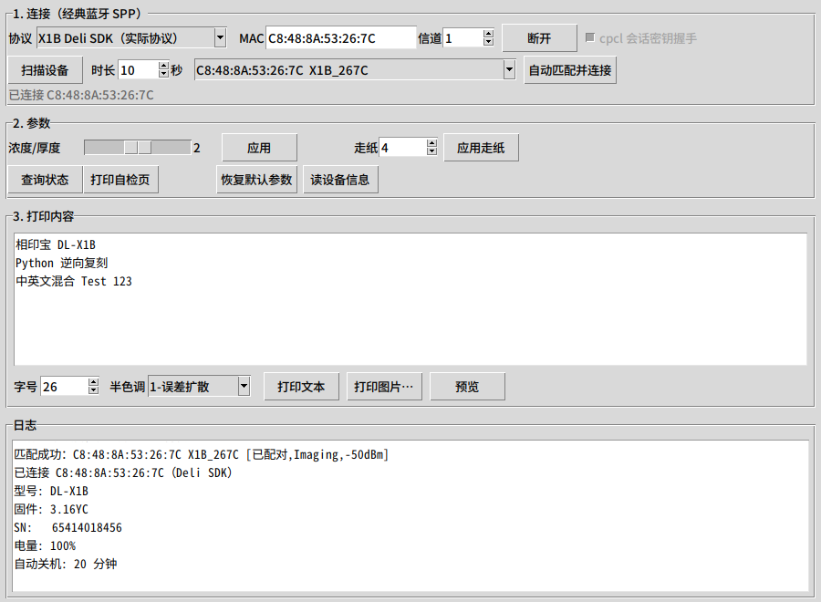
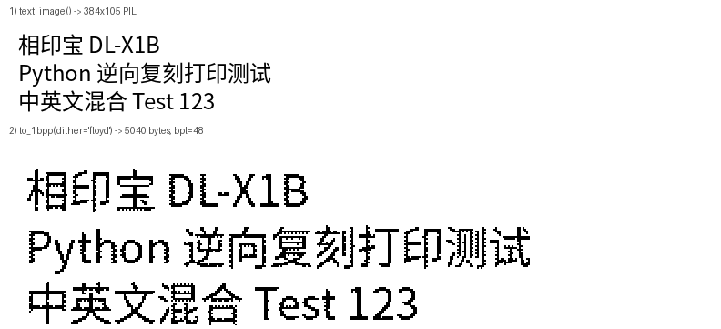
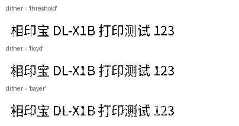

# 相印宝 / 得力 DL-X1B 蓝牙打印逆向复刻

> [!IMPORTANT]
> **AI 生成声明（AI-Generated Content）**
> 本仓库的代码、测试、文档与提交均由 AI（DeepSeek，deepseek-flash 模型）生成或大幅改写，
> 生成后经真机验证与人工审阅。协议结论以真机实测为准；按本仓库操作导致的设备异常、
> 耗材浪费或数据丢失，由使用者自行承担。


从 `hwxyb.apk`（得力「相印宝」App，包名 `com.feioou.abroad`）里**静态逆向**出
DL-X1B 热敏打印机的打印协议，并用 Python 重写了一套可用的驱动 + 测试界面。

* 打印机：得力 DL-X1B，2 英寸、**384 点**、203dpi，蓝牙热敏
* 连接：**经典蓝牙 SPP**（secure `createRfcommSocketToServiceRecord`，UUID
  `00001101-0000-1000-8000-00805F9B34FB`），不是 BLE；连接失败每 200ms 重试、3s 超时
* 打印协议：**App 内的 `com.deli.sdk.PrintPP`（得利自研 SDK）**——裸命令流 + 标准
  ESC/POS `GS v 0`（`1D 76 30`）未压缩 1bpp 点阵
* 同 App 的旧机型 X1 用的是另一套 `cpcl` 协议（包封 + CRC32 + 会话密钥），本仓库也保留了
* 设备发现：**自动扫描 + 匹配**（复刻 App 的过滤规则，蓝牙里同名 BLE 孪生会被排除）
* 平台：Linux 用 BlueZ `bluetoothctl`；**Windows 用系统蓝牙 API（`bthprops` 枚举 +
  winsock RFCOMM 连接），无需 PyBluez / pywin32**；macOS 走已配对串口
* 真机验证：已在 DL-X1B（`C8:48:8A:53:26:7C X1B_267C`）上自动匹配 → 连接 → 读信息 → 出纸成功，
  完成信号是本机固件的 `AA`+`BB`（不是 App 期望的 `"OK"`）

| | |
|---|---|
|  |  |



<sub>上图：同一段文本在 `threshold`（原厂判据）、`floyd`（误差扩散）、`bayer`（有序抖动）
三种打包模式下的点阵效果，均为 384 点宽。</sub>

## 目录结构

```
相印宝逆向/
├── deliprint/             ← ★ 核心：DL-X1B 实际协议（传输 + 命令 + 图像编码），UI 不参与
│   ├── commands.py         命令字节表（10 FF … / 1B 4A / 1D 76 30），含出处注释
│   ├── transport.py        传输层：蓝牙 SPP / TCP / 串口 / 回环（离线虚拟打印机）
│   ├── raster.py           图像→1bpp（原厂均值判据、Floyd–Steinberg、Bayer）+ 文本渲染
│   ├── winbt.py            Windows 后端：bthprops 枚举 + winsock RFCOMM（纯 ctypes）
│   ├── discovery.py        自动扫描 + 匹配（Linux: bluetoothctl / Windows: 系统蓝牙 API）
│   └── printer.py          打印驱动：连接/断线重连、打印时序、1024 分块、同步查询、完成判定
├── dlx1b/                 ← 同 App 旧机型 X1 的 cpcl 协议（附录 A），保留对照
│   ├── frame.py            02…03 包封、带密钥 CRC32、增量解析、命令码/状态表
│   ├── transport.py        RFCOMM / 串口 / TCP / 回环
│   ├── raster.py           三种原厂半色调（阈值 / Floyd–Steinberg / 8×8 cluster-dot）
│   └── printer.py          cpcl 驱动（握手、序号、等应答、分帧发送）
├── demo/
│   ├── print_test_gui.py  Tkinter 测试界面（协议可选，默认 DL-X1B / Deli SDK；白底点阵预览）
│   ├── print_text_cli.py  命令行打印（--dump 可离线导出字节流）
│   └── decode_dump.py     把 hex dump 解回 cpcl 帧表（排查真机日志用）
├── API.md                 ← 协议 + Python API 文档（命令表、时序、证据索引）
├── tests/                 离线自测（点阵/帧/打印序列/Windows 后端，pytest）
├── docs/                  截图
├── work/                  逆向中间产物（jadx/apktool/Ghidra；体积大，未入库）
└── hwxyb.apk              原始样本（未入库，请自行获取）
```

## 快速开始

```bash
pip install pillow                  # 文本/图片渲染
pip install pyserial                # 仅当走串口时需要
```

平台说明：Linux 扫描用 `bluetoothctl`（`apt install bluez`）；Windows 上扫描和连接
都用系统自带接口（扫描走 `bthprops`，连接走 winsock 的 RFCOMM），**不需要 PyBluez
或 pywin32**，但打印机要**先在「设置 → 蓝牙和其他设备」里配对**——配对后即使它休眠
也能被枚举到。macOS 没有 `AF_BLUETOOTH`，请用 `SerialTransport`（已配对串口）。

```python
import deliprint

# 自动扫描 + 匹配 DL-X1B（名字含 X1B、排除 BLE 孪生、优先已配对/Imaging），不用手抄 MAC
dev = deliprint.find_printer(10)
print(dev)                                    # C8:48:8A:53:26:7C X1B_267C [已配对,Imaging,-46dBm]

p = deliprint.DeliPrinter.auto_connect(10)    # 扫描 → 匹配 → 连接
try:
    print(p.read_model(), p.read_version(), p.read_sn())   # DL-X1B 3.16YC 65414018456
    print(p.read_battery(), "%", p.read_shut_time(), "min")
    p.print_text_page("你好，DL-X1B！\n第二行 Test 123", dither="floyd", font_size=24)
    p.wait_print_finished(timeout=30)              # 真机 2~3s 返回 True（AA+BB）
finally:
    p.disconnect()
```

或者直接指定 MAC（系统里已配对）：

```python
p = deliprint.DeliPrinter.connect_bt("AA:BB:CC:DD:EE:FF")
```

图形界面（带「扫描设备 / 自动匹配并连接」）：

```bash
python3 demo/print_test_gui.py          # 手动连接
python3 demo/print_test_gui.py --auto   # 启动即扫描、匹配、连接
```

命令行扫描 / 自动连接：

```bash
python3 demo/print_text_cli.py --scan                 # 只列出发现的设备
python3 demo/print_text_cli.py --auto --text "hello"  # 匹配后直接打印
```

不接打印机也能验证（离线导出字节流并打印结构摘要）：

```bash
python3 demo/print_text_cli.py --text "hello" --dump work/frames_deli.hex
```

跑自测（点阵位序、GS v 0 帧、完整打印序列、1024 分块、状态分发、扫描解析/匹配打分、
Windows 扫描后端的 MAC 转换/结构体布局/Device 映射）：

```bash
python3 -m pytest tests/ -v
```

## 协议要点（详见 [API.md](API.md)）

```
enablePrinter   10 FF FE 01
printerWakeup   1024 × 0x00
choosePaperType 10 FF 84 03          (3 = 2 英寸)
printLinedots   1B 4A 00
printBitmap     1D 76 30 00 30 00 4E 00  + 48×78 字节点阵
printLinedots   1B 4A 8C             (140 点行)
stopPrintJob    10 FF FE 45
```

* 命令是**裸字节流**：没有包头/长度/CRC/序号（这点与同 App 的 cpcl 协议完全不同）。
* 图像头就是标准 ESC/POS `GS v 0`：`1D 76 30 <mode> <xL xH> <yL yH>`，`x = ceil(宽/8) = 48`。
* 点阵：**MSB 在前、1=黑**，判黑 `(R+G+B)/3 < 128`（原厂用的是算术均值，不是亮度加权）。
* 发送：每 **1024 字节**一块，块间 sleep 1ms；写失败/断开由上层处理。
  长图（>6 KB 点阵）依赖 socket 阻塞写做流控——读线程用 `select` 等待，
  不能把 socket 超时设成几十毫秒，否则大图会断在半路（已修）。
* 应答（App 侧代码）：状态 `FF xx`（`&0x04` 缺纸、`&0x08` 低压、`0` 正常）；
  一页打完回 ASCII `"OK"`。
* **真机实测（固件 3.16YC）** 与 App 期望不同：没有 `FF xx` 状态推送；
  `stopPrintJob` 后 ≈1.5s 回 `AA`、再 ≈0.6s 回 `BB`（本库把 `AA`+`BB` 也判为完成）；
  查询回包是裸 ASCII/GBK（型号 `DL-X1B`、固件 `3.16YC`、SN `65414018456`）
  或 2 字节数值（`00 64` = 电量 100%、`00 14` = 关机 20 分钟）。
* App 的真实时序：`enable → wakeup → choosePaperType(3) → printLinedots(0) →
  printBitmap(bitmap,0) → printLinedots(140) → stopPrintJob`；`mode` 恒为 0，
  每份都整套重发，命令之间没有显式延时。
* 连上后 App 按 `SN → 电量 → 关机时间 → 版本 → 状态` 查询（`read_all_info()` 同序）；
  本库另有同步版 `read_model()/read_version()/read_sn()/read_battery()/read_shut_time()/read_status()`。
* 另有一个值得注意的发现：App 的**「打印文本」**在 X1B 上走到了 HPRT 通道
  （端口从未打开），静态判断会失败，疑似 App 自身缺陷；本库自己渲染点阵，不受影响。

## 逆向方法（为什么这些结论可信）

1. `apktool d` 解出 18091 个 smali；`MainActivity` 的蓝牙发现回调按设备名分支，
   名字含 **`X1B`** → `AYPrintUtil` → `com.deli.sdk.PrintPP`（Deli SDK）。
   App 里 `X1_NAME` 是完整串 `"XiangYinBao_X1"`，所以 `X1B` 不会被误判成 X1。
2. `PrePrintImgActivity.java:665-681` 的 `device_type == "X1B" || "X3B"` 分支给出了
   完整打印时序；`BitmapFlex.compressPic` 证明 X1B 的位图宽度是 `Contants.X1_RADIO = 384`。
3. 逐方法读 `com/deli/sdk/{e,a,b,c,f,g,PrintPP}.java` 与 `e.smali` 的 `.array-data`，
   拿到全部命令字节、GS v 0 帧头、1bpp 打包规则、1024 分块、状态与 OK 的解析方式。
4. 同时把同 App 的 `cpcl/` 包完整还原（附录 A）：`02…03` 包封、带密钥 CRC32、
   会话密钥协商、1440 字节/帧、三种半色调——用于对照与 X1 机型兼容。
5. 原生库核对：`libhprt_printer_helper_cmd.so`（Ghidra + DWARF）是 ESC/POS 编码器，
   服务 App 里的汉印机型；`libMD5CheckPrinter.so` / `libLZO.so` 属 OTA 通路；
   `com.deli.sdk.Code` 是 native 且 **APK 内没有对应 `libCode.so`**，因此 X1B 打印
   只可能走未压缩的 `GS v 0` 路径（与本仓库实现一致）。

## 已验证 / 未验证

**已验证（真机）**：DL-X1B（`C8:48:8A:53:26:7C X1B_267C`，已配对）。

* 自动扫描能发现打印机，并正确排除同名 BLE 孪生 `C9:48:8A:53:26:7C X1B_267C_BLE`；
* SPP 连接成功（信道 1）；
* `print_text_page(...)` 完整发送（enable → 1024×0 → paper → GS v 0 → 走纸 → stop），
  打印机回 `AA`+`BB`（`wait_print_finished` 2.6s 返回 True），**实际出纸**；
* 同步查询全部有应答：型号 `DL-X1B`、固件 `3.16YC`、SN `65414018456`、电量 100%、
  自动关机 20 分钟、状态 `0x00`；
* **图片打印**（`print_image_page`，384×220 与 384×400 长图均实测出纸）；
* 链路被回收（关掉底层 socket）后 `read_model()` 仍能自动重连并返回正确值；
* GUI「读设备信息」按钮在同一台机器上实测输出上述四项信息（见首图日志）；
* **Windows**：GUI「扫描设备」用系统蓝牙 API 枚举出 `X1B_267C`（并排除同名 BLE 孪生），
  `BtSppTransport` 走 winsock 连接信道 1 成功，状态查询回 `0x00`——全程无第三方库。

**已验证（离线）**：命令字节与帧头、1bpp 打包位序与均值判据、1024 分块、
完整打印序列的字节流（CLI dump + 单元测试）、文本/图片→点阵渲染、
扫描输出解析（含 `(public)`/`RSSI:` 伪名、BLE 过滤、打分排序）、GUI 本机正常运行。

**未验证**：

* 其它固件版本的查询应答格式（本机 `3.16YC` 已实测；换机器请先用 `request()` 看原始字节）；
* `GS v 0` 的 `mode=1..3` 在固件上的实际效果（App 恒传 0，本库默认也用 0）；
* 长图分页（App 用 `ImageSplitter` 切页，本库目前一次发完整点阵）与 `wakeup` 是否必需；
* App 的文本打印入口在 X1B 上是否真的不可用（静态判断为走错 SDK，需真机验证）。

真机调试建议：先跑 `python3 demo/print_text_cli.py --scan` 确认能扫到 `X1B`；
出图异常时对照 [API.md](API.md) 2.3 的位序和宽度（必须 384 点）。
若扫描不到：打印机空闲会自动关机，按一下电源键再扫；Windows 上还要先在
「设置 → 蓝牙和其他设备」里配对该打印机（未配对也能扫到，但连不上）。

## 许可与声明

仅用于个人设备的互操作研究与自有内容打印；协议来自公开可获取的 APK 静态分析，
未包含任何原厂代码或密钥素材。设备行为以真机为准。
